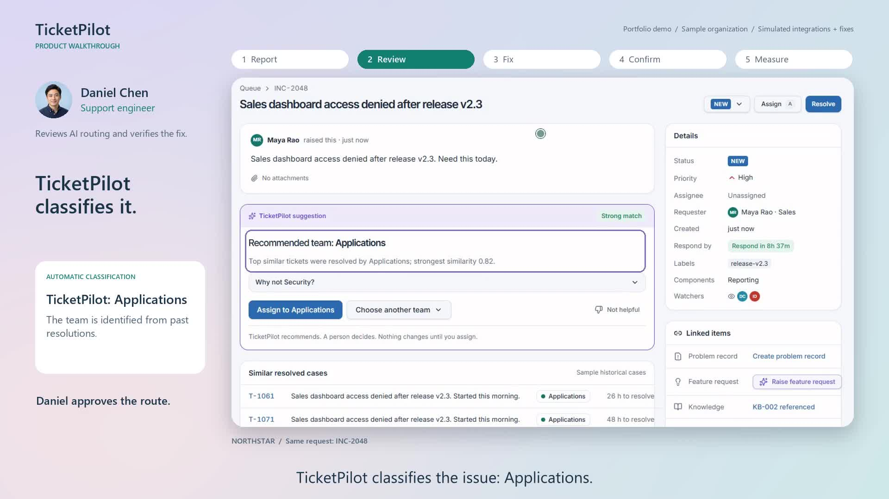
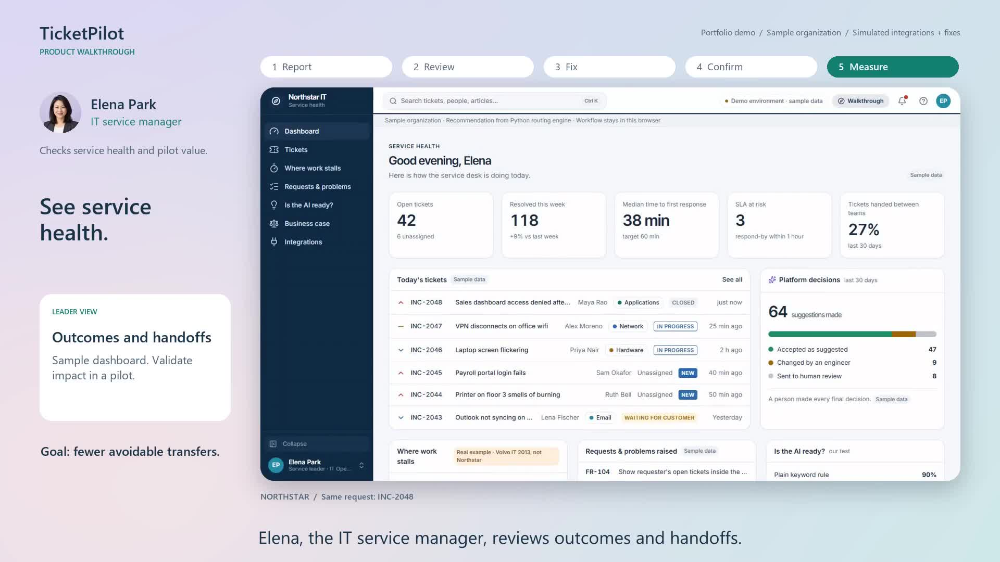

# Experience design and demo evolution

## The product story

Follow one dashboard access request, INC-2048, through a fictional organization:

1. Maya, a sales employee, describes her problem without selecting the owning team.
2. TicketPilot classifies the issue and proposes Applications using matched resolutions.
3. Daniel, the support engineer, inspects source evidence and approves/overrides routing.
4. Suggested instructions become verified work only after a resolver acts and records it. The actual access change is simulated.
5. Maya receives an understandable update and confirms the outcome, or asks for more help.
6. Elena, the IT service manager, sees a management view. Its statistics are sample data; they are not evidence of achieved savings.

Classification, routing approval, work execution and outcome confirmation are separate product responsibilities. The latest videos and captions make that distinction explicit.

## Feedback and the resulting product decisions

| Feedback from this project | Interpretation | Change made | What remains unproven |
| --- | --- | --- | --- |
| The app feels like a test summary to a C-suite buyer | Technical evidence lacks an understandable work context | Lead with a process problem and a real request journey; move technical evidence to a separate workbench | Executive comprehension and purchase interest |
| An end user cannot tell what is happening | Role changes and state transitions need orientation | Persona roles, one shared request, explicit statuses, guided onboarding | Task success and error reduction with unfamiliar users |
| Include Slack/Jiminny-style tutorial guidance | Explain the relevant action at the moment it matters | Optional anchored tour with back/skip/restart and contextual explanations | Tutorial completion and usefulness |
| Show how it fits an organization | Need familiar work surfaces and handoffs | Employee portal, support workspace and manager view; describe intended integrations honestly | Actual connector feasibility and organizational adoption |
| Rounded window, contrasting background, quick persona introduction | Presentation needs visual hierarchy and people context | Soft app frame, lavender/blush/blue background, fictional portraits and role introductions | No business outcome is implied by visual polish |
| Pacing is fast; value and actions are unclear | More dwell time and explanation are needed | 3:43 walkthrough with title card, progress strip, source/fix callouts and reading pauses | No formal before/after comprehension study |
| A shorter visitor introduction is useful | Not every visitor will start with a long walkthrough | Separate 60-second trailer that preserves the core request-to-outcome story | No measured visitor conversion uplift |
| It sounds as if Daniel classifies the issue | Human approval language obscured the automated step | Explicit TicketPilot classification; Daniel approves/overrides routing | Formal understanding of responsibility split |
| Say Elena's role, not just her name | Names alone do not establish a job context | Spoken and written introductions for Maya, Daniel and Elena the IT service manager | Independent role recall |
| Add copyright-free background music | Sound can support pacing, but speech must remain clear | Original procedural instrumental with no third-party recordings/samples; ducking and fades | Listener preference has not been studied |

These are project-owner feedback iterations. Do not relabel them as interviews with customer executives or a formal research sample.

## Tutorial flow for the intended experience

Start with an optional invitation: follow Maya's request or explore freely. Orient the viewer to the active persona and their task before explaining a feature. A useful tour sequence is report -> classify -> inspect evidence -> approve route -> review/record work -> confirm outcome. Keep a manager-specific view available for process and investment questions.

Each step should identify the action, why it matters and what happens next. Skip/back/restart must work without losing the demonstration's case context. Show retry on API failure, explain abstention, and provide an unresolved path. Suggested work must never silently become completed work because the viewer advanced a tutorial.

The portfolio narrative should explain the intended service-desk integration without implying ServiceNow, Teams or ERP connectors are live. The familiar workspace is an experience prototype, not a deployed tenant.

## Current media

- [60-second trailer](media/watch-trailer.html): visitor orientation and concise value proposition.
- [3:43 walkthrough](media/watch-demo.html): role/context, classification, evidence, approval, simulated work and outcome.
- [Narration transcripts](media/transcripts/README.md): exact current scripts and timing.
- [Earlier cuts](media/archive/README.md): reference material for explaining iteration decisions.

Footage records the actual integrated local app in an isolated headless browser, with user authorization. New request capture verified a Python routing response. Edited holds and cuts make room for explanation; runtime is not measured task performance. Narration is synthetic English speech, portraits are fictional AI-generated assets, and music is an original procedural composition.

## Release-quality observations

The current media passed full decode, runtime, caption, audio and browser-player checks. The players were checked for horizontal overflow on a narrow viewport. That does not establish mobile usability of every application route. Two recoverable React hydration warnings were retained from capture. A public cloud deployment and Docker runtime are separate unfinished checks.
